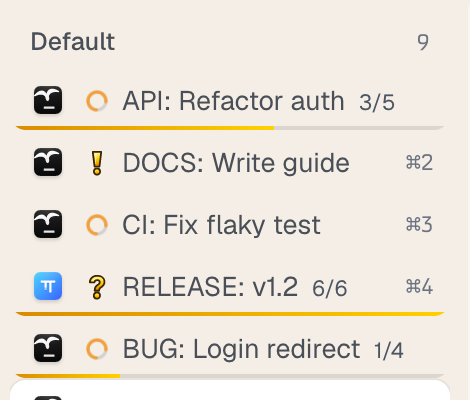

# Agent Progress

A [Tern](https://stencil.so/tern) plugin that marks every tab holding an [omp](https://github.com/can1357/oh-my-pi) agent, WoW quest style.



| Agent state | Mark |
| --- | --- |
| working | spinning orange ring |
| waiting for input | gold quest `!` |
| finished while you were in another tab | gold turn-in `?`, cleared when you open the tab |

When the agent has a todo list, the tab also gets a thin gold bar along its bottom edge and a `done/total` count.
A finished list stays visible only while the agent is still working or its result is unseen.

## Install

```sh
tern plugin install github.com/Sipty/tern-agent-progress
```

Remove it with `tern plugin remove agentprogress`.

To hack on it, clone the repo and `tern plugin link` the clone instead; edits take effect after `tern plugin reload`.

## How it works

The window half polls `cx.agents:list()` once a second.
Todo counts come from the `target` (`"3/5"`) of the newest `todo` tool call in `cx.agents:transcript()`.
Transcript reads are synchronous and a timer tick has a 50 ms budget, so each tick reads at most one transcript, and a working agent is re-read at most every 4 s.

The marks are drawn by a generated stylesheet (`tern.css("tabs", …)`), not by `tern.chrome.tab_title`.
In Tern 0.7.2 the title formatter only reaches the horizontal tab bar, and tab rows carry no per-tab state classes, so rules target each row by position: `button.nav-row:nth-of-type(N)` in the vertical list and `button.tt:nth-of-type(N)` in the horizontal bar.

## Limits

- Only tabs of the current session are marked; other sessions' groups in the vertical list are not addressed.
- In the horizontal bar the count makes narrow tabs truncate sooner.
- Row selectors depend on Tern's internal tab markup and may break on a Tern update.
